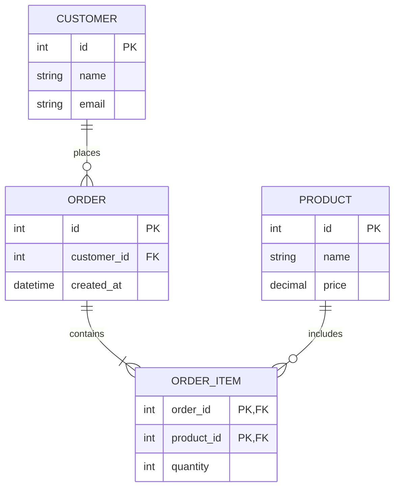

# Database Diagrams

This directory contains database diagrams documented in Markdown using [Mermaid](https://mermaid.js.org/). Diagrams are intended to be written, maintained, and viewed with the **Markdown Preview Mermaid Support** extension in Visual Studio Code.

## Requirements

- [Visual Studio Code](https://code.visualstudio.com/)
- [Markdown Preview Mermaid Support](https://marketplace.visualstudio.com/items?itemName=bierner.markdown-mermaid)

## Usage

1. Open a diagram's `.md` file in VS Code.
2. Edit the Mermaid diagram code inside a fenced code block using the `mermaid` language identifier.
3. Open the Markdown preview:
   - **Windows/Linux:** `Ctrl + Shift + V`
   - **macOS:** `Cmd + Shift + V`
4. Use `Ctrl + Shift + V` / `Cmd + Shift + V` to open the preview, or use **Markdown: Open Preview to the Side** to view the source and rendered diagram together.

## Writing Diagrams

Use Mermaid code blocks to define diagrams directly in Markdown.

For example, a database entity relationship diagram:



## Conventions

- Store database diagrams in this directory as Markdown (`.md`) files.
- Use Mermaid code blocks for diagrams so they can be rendered in the Markdown preview.
- Give each file a descriptive name that reflects the database domain or diagram purpose.
- Keep diagrams consistent with the current database schema.
- Document important relationships, primary keys (PK), foreign keys (FK), and relevant constraints.
- Prefer small, focused diagrams over a single diagram that is difficult to read.
- Update the relevant diagrams whenever the database schema changes.


```

## Notes

Mermaid diagrams are stored as plain text within Markdown files. No separate image files or diagramming tools are required.

The diagrams should remain readable in source control, easy to review in pull requests, and straightforward to update alongside database changes.